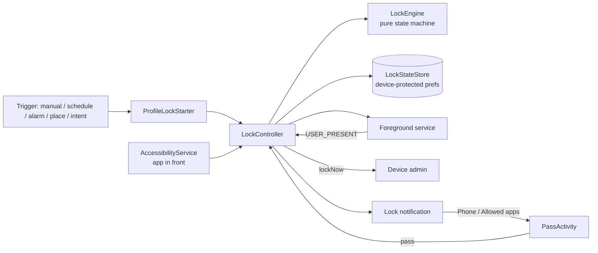

# LockMyPhone Extended

An Android app that locks your phone for a set time, and keeps it locked. It recreates the idea of Thomas Kahn's *Lock My Phone*: during a lock, **every unlock locks the phone again immediately**. Only calls, emergency calls and apps you allowed stay usable.

On top of that it adds automatic triggers (schedules, alarms, places, other apps), allowed-app passes, a timed early-unlock escape hatch, Do Not Disturb and grayscale during locks, and device-aware handling of each manufacturer's system screens.

> **Status: 0.9.0 pre-release.** The core lock, passes, schedules, early unlock and intent API have been tested on a Pixel 7 and the Android emulator. Several newer features (listed under [Test status](#test-status)) are built but not yet tested on a device. Emergency mode isn't built yet.

---

## Contents

- [Features](#features)
- [Install](#install)
- [First-time setup](#first-time-setup)
- [Common use cases](#common-use-cases)
- [Architecture](#architecture)
- [Intent API (MacroDroid, Tasker…)](#intent-api-macrodroid-tasker)
- [FAQ](#faq)
- [Known limits](#known-limits)
- [Building from source](#building-from-source)
- [Test status](#test-status)

---

## Features

### The lock
- **Locks again on every unlock** during a lock, like Lock My Phone. The lock survives reboots and app updates, because the end time is stored as a wall-clock timestamp.
- **Quick lock:** set the length (H:M:S or one-tap presets), allowed apps and options on the Quick lock tab, then tap **▶ Start** at the top. Everything is remembered for next time. ↻ copies your Lock defaults back in.
- **Profiles:** named, reusable locks, each with an icon (built-in icons or any emoji). You can drag them to reorder, and start one with ▶ (it asks Cancel / Go and uses the profile's length).
- **Lock defaults:** a baseline that new profiles start from, and that Quick lock can copy.
- **Countdown screen:** while locked, the app shows only the time left and the end time, so settings can't be changed mid-lock.

### During a lock
- **Allowed apps:** open them from the lock-screen notification (Phone, Allowed apps…). Opening any other app locks the phone again.
- **Allowed-apps screen:** OLED black, with the time and date top-left and the time left top-right. Clock size, app-name size, font (built-in or your own .ttf / .otf), status bar and time left are set under Settings → Appearance.
- **Home during a lock:** by default, Home (or the app switcher) opens the allowed-apps list again. Settings → During a lock → *Home opens…* can make it open the countdown screen, or lock the phone instead.
- **Hidden allowed apps:** 👁 next to a checked app keeps it allowed but out of the list. The camera is allowed and hidden by default, so "take a photo" in WhatsApp or Messages, and the double-press camera, work during a lock.
- **System pickers:** the file picker, photo picker and share sheet always work inside allowed apps. Opening a file or sharing into another app still locks.
- **Assistant popup:** optional (Settings → During a lock, off by default). Allows only the Gemini / Assistant popup from the power button or a corner swipe; the full Google and Gemini apps still lock.
- **Accessibility overlays** (e.g. a grayscale app) don't count as leaving an allowed app.
- **Back to where you were:** if the screen turns off inside an allowed app, unlocking can either return you to that app, or show the countdown screen and lock again after a few seconds unless you pick an app. You choose this per profile.
- **Early unlock:** optional, per lock. Request it from the lock-screen notification, then wait N minutes before the lock ends. It can be cancelled.
- **Do Not Disturb:** optional, at a level of your choice: Priority only, Alarms only, or Total silence. It uses the app's own modes, so your manual DND is never overwritten.
- **Grayscale:** optional (Android 15+). The screen turns gray when the lock starts and returns to colour when it ends.
- **One pinned notification** shows the countdown and has the Phone / Allowed apps / Unlock early buttons.

### Which lock wins (one lock at a time)
Only one lock runs at a time. When a lock tries to start during another, their kinds decide:

| Rank | Kinds |
|---|---|
| 1 (strongest) | Commitments you set up in advance: **schedules, calendar triggers, places, alarm triggers** |
| 2 | **NFC tags** set to *Take over a running lock*, and the **intent API** (MacroDroid, Tasker…) |
| 3 | **Manual**: Quick lock and a profile's ▶ Start |

- **A stronger lock replaces the running one** with its own settings and its own length (even if that ends sooner).
- **An equal or weaker lock is refused.** Manual starts and NFC taps say so, e.g. *"Already in a schedule lock (Night) until 7:00 AM!"*. A refused automation is skipped.
- **Clash warnings:** schedules, places with time slots and calendar triggers that would overlap show *⚠ Clashes with …* in their list and editor (whichever starts first runs; the other is skipped). Places without time slots, alarms, NFC and intent starts can't be predicted.
- Emergency mode (not built yet) will outrank everything. See [ADR 0005](doc/adr/0005-one-lock-at-a-time-ranked-by-kind.md).

### Automations (start locks automatically)
- **Weekly schedules:** days + start and end time, overnight included. Stopping a scheduled lock early (by intent or early unlock) cancels the rest of that window.
- **Alarm triggers:** lock after you dismiss an alarm. Snoozes don't count.
  - **A specific alarm:** learned from one ring, or picked from QRAlarm's upcoming alarms without waiting for it to ring.
  - **The first alarm of the day:** from Google Clock and/or QRAlarm, whichever alarm you dismiss first. Handy when you wake at different times.
  - **Timers never count.**
  - **Active on:** every day, chosen weekdays, once, or specific dates. A configurable "day starts at" time (default 2:00 AM) decides which day a late-night alarm belongs to.
  - **Missing alarms:** a warning if a learned alarm seems to have been deleted, with a one-tap **Re-link** when a re-created one is spotted.
- **Places (location triggers):**
  - **A place is recognised by any mix of signals:**
    - a GPS circle (25–2000 m)
    - a specific Wi-Fi router (its unique BSSID, exact to a building or room)
    - a **Bluetooth beacon** (an ESP32, a coin-cell iBeacon/Eddystone, or a tablet in beacon mode; about 1–3 m, calibrated at your spot)
    - a **paired Bluetooth device**, with no app on it: *when connected* (car, speaker, headphones, watch, keyboard; exact, no scanning) or *when nearby* (experimental; works with some watches and earbuds, and the picker shows whether yours does)
    - being **on a charger** (any, or wireless only, e.g. the pad on your desk)
  - **Combine them:** *all of them* (the strictest) or *any one of them* (the most reliable).
  - **Behaviours:** lock *while I'm here*, *on arrival*, *when I leave*, **during time slots**, or **only as a condition** for other automations:
    - several slots per place, each with its own days
    - you choose whether to lock again when you come back mid-slot
    - you choose whether leaving unlocks or keeps the lock until the slot ends
  - **Engine:** Google Play Services geofencing (default) or Android's built-in location (no Google needed).
  - **"Only while at ‹place›":** schedules and calendar triggers can require a place. They lock only while you're there; arriving mid-window starts the lock, and it lasts until the window ends.
  - **Act as a beacon:** turn a tablet or spare phone into a beacon (always, or during set hours), so "near my tablet" works as a portable desk in cafés and libraries. It runs as a quiet foreground service; allow unrestricted battery on Samsung, Nothing and similar phones.
  - Build your own desk beacon: [doc/esp32-beacon.md](doc/esp32-beacon.md).
- **Calendar triggers:** lock during calendar events.
  - Match by chosen calendars and/or keywords in the title (optionally also notes and location). All-day events are optional.
  - The lock lasts until the event ends, or for a set length from its start, with an optional early start.
  - Declined and "free" events can be skipped; the defaults are in Settings.
  - Recurring events work. Moved or deleted events are picked up automatically, and a live "Next match" preview shows what would lock.
- **NFC tags:** tap a tag to start a lock, end one, or both (start when none is running, end during one).
  - **Nickname and ID:** each tag has a nickname (e.g. "Fridge") and shows its hardware ID, so you can tell which physical tag runs which lock.
  - **Linked locks:** one lock (the default: a tap starts it straight away), several, or all of them (a tap asks which one to start). Each profile and Quick lock shows *NFC tags linked here*.
  - **During a lock, a Start tag** says a lock is already running, unless *Take over a running lock* is on: then it switches a manual lock to its own (it never replaces a schedule, calendar, place or alarm lock).
  - **During a lock** a tag can: start the lock's early-unlock wait (the default), end it if it's one of the tag's linked locks, or end any lock.
  - **Only written tags can end a lock.** *Write to tag* puts a link with a random code on the tag, and ending checks both the tag's ID and that code. A tag that was only scanned (or a read-only card) can still start locks and the early-unlock wait.
  - **Saving writes the tag:** Save on a new tag asks you to hold it to the phone and writes it; *Save without writing* keeps it, dimmed in the list until it's written.
  - **After an unlock** during a lock that a tag can end, the countdown screen waits a few seconds (default 10) for the tag before locking again. Ending only works there, never from a tag tapped elsewhere.
  - **Scan tag vs Write to tag:** *Scan* only reads the tag's ID, so the tag works while the app is reading (the countdown screen, the editor). *Write* also stores the app's record and code on the tag, so it can end locks and works while the app is closed.
  - **Limit:** the code on a tag can be read by any NFC app. Copying a tag still needs your physical tag and a special tag whose ID can be changed.
  - Put the tag somewhere you have to walk to, so ending a lock is a conscious choice.
- **Intent API:** start or stop locks from MacroDroid, Tasker and similar apps (see [below](#intent-api-macrodroid-tasker)).

### Backup
- **Back up now / Restore:** everything (settings, Lock defaults, Quick lock, profiles, schedules, alarm, location and calendar triggers, NFC tags) as one JSON file, in a folder you pick (e.g. one synced to Google Drive).
- **Restore replaces everything,** after a confirmation that lists what may need attention on a new phone. The intent-API stop token is never included.
- **Auto backup:** 10 minutes after your last change, then idle until the next change. Keeps the last 10, in the backup folder or a folder of its own.
- **Not included:** the stop token, and *Act as a beacon* (each device keeps its own beacon ID).

### Permissions
- **Settings → Permissions** lists every permission, allowed or not, why it's needed and what uses it, with **Allow**, **Manage** (Android's own page) and **Revoke**.
- **Revoke** works in-app for device admin, accessibility and, on Android 13+, runtime permissions such as location, calendar and nearby devices (the app closes so Android can apply it). The rest open the right settings page.
- Nothing is deleted: places and triggers that need a missing permission show **⏸ Paused: needs …** and work again once it's allowed.

### Quality of life
- **Tabs:** Quick lock · Profiles · Automations · Settings, in a bottom bar.
- **Icons and order:** for profiles, schedules, alarm triggers, places, calendar triggers and NFC tags; long-press a row to drag it.
- **Themes:** System, Light, Dark and OLED black.
- **App lists:** fast and searchable, with selected apps listed first.
- **Setup and device profiles:** a setup checklist that only shows what's still missing, and device profiles for Pixel, Samsung, Nothing and generic Android, with a Diagnostics log for adding new ones.

---

## Install

1. Download the APK from **[Releases](../../releases)**.
2. On the phone, allow installing from your browser or file manager when asked, then open the APK.
3. Open **LockMyPhone Extended** and follow the setup checklist.

> The release APK is signed with a **debug key**. That's fine for sideloading. Google Play won't accept this kind of app anyway (see the [FAQ](#faq)). If you later install a build signed with a different key, you'll have to uninstall first.

Requires **Android 11 (API 30)** or newer. Grayscale needs Android 15+.

---

## First-time setup

The checklist on the **Settings** tab only shows what's still missing:

| Permission | Why |
|---|---|
| **Device admin** | Locks the phone again (`lockNow`). Required. |
| **Notifications** | The lock countdown and its buttons. |
| **Accessibility service** | Sees which app is in front, so allowed apps work and leaving them locks. It doesn't read screen content. |
| **Run in background** (battery unrestricted) | Keeps enforcement reliable, especially on Samsung and Nothing phones. |
| **Do Not Disturb access** | Only if a lock uses DND or grayscale. |
| **Notification access** | Only if you use alarm triggers (to see alarms ringing). |
| **Precise location + "Allow all the time"** | Only if you use location triggers (Android also requires it for Bluetooth beacons). |
| **Nearby devices** | Only if a place uses a Bluetooth beacon or a paired device, or this device acts as a beacon. |
| **Calendar** (read-only) | Only if you use calendar triggers. |
| **NFC turned on** (a switch, not a permission) | Only if you use NFC tags. |

---

## Common use cases

- **"No phone for the first hour after I wake up" (weekdays):** an alarm trigger on your QRAlarm alarm → a 1-hour profile, with Chosen weekdays Mon–Fri.
- **"Only a walk to the kitchen ends it":** a written NFC tag nicknamed "Fridge", linked to the profiles you want it for and set to *End a lock → End it, if it's one of this tag's locks*. Or keep the default, *Start the early-unlock wait*, so the walk only starts the countdown.
- **Weekends, when you don't know which alarm will wake you:** an alarm trigger set to *The first alarm of the day* from Clock + QRAlarm, active Sat–Sun.
- **Bedtime:** a schedule, 22:30 → 07:00 every day, starting a "Night" profile with Alarms-only DND and grayscale.
- **Focus at the office:** a location with *During time slots* Mon–Fri 9:00–12:00 and 13:00–17:00, matched by *GPS or Wi-Fi* (the office router makes it exact indoors).
  - Choose whether stepping out for lunch unlocks or keeps you locked until the slot ends.
- **Gym:** a location with *While I'm here*, allowing only your music app and the timer.
- **"Only when I sit at my desk":** an ESP32 beacon on the desk → a place with the beacon signal and *During time slots* Mon–Fri 9:00–17:00. Sit down and it locks after about 45 s.
- **Portable desk:** turn on *Act as a beacon* on your tablet. A place with that beacon → the phone locks whenever you work next to the tablet, at home, a café or the library.
- **Phone on the pad = phone away:** a place with *Wireless charger only* and *While I'm here*. Lifting the phone ends the lock.
- **Study schedule, but only at home:** a schedule Mon–Fri 19:00–21:00 with *Only while at: Home*. Out that evening? No lock. Home at 19:40? It locks until 21:00.
- **From another app:** a MacroDroid macro sends `START_LOCK` with `profile=Study` when you connect to a certain Bluetooth device.
- **A quick 25-minute focus burst:** Quick lock → tap the 30m preset (or your own) → ▶ Start.
- **Commute:** a location on your home Wi-Fi with *When I leave* → a 45-minute lock.
- **Deep work from your calendar:** a calendar trigger on keyword "Focus" in your Work calendar → locks for exactly the length of each focus block.
- **New phone:** Settings → Backup → Restore from a file… (the backup can come from a Drive-synced folder). Then:
  - re-grant the permissions
  - re-pick your QRAlarm alarms, whose internal numbers are per phone

---

## Architecture

A single-module Android app in **Kotlin + Jetpack Compose (Material 3)**. It uses a manual dependency container (no Hilt), Room for data, and SharedPreferences for single values.

```
com.fabiantorrestech.lockmyphone_extended
├── core
│   ├── lock      LockEngine (pure rules), LockController, LockState/Store, end alarm
│   ├── enforce   Device admin receiver, Relocker (lockNow), AccessibilityService, ForegroundPolicy
│   ├── service   Foreground service (USER_PRESENT / screen on-off), BootReceiver
│   ├── notify    Lock notification, trigger warnings
│   ├── dnd       DND levels + grayscale via app-owned AutomaticZenRules
│   ├── oem       Per-manufacturer profiles + detector
│   └── apps      App list, icons, caches
├── pass          PassActivity: grants an allowed-app pass from the lock screen
├── bypass        Early-unlock notification actions
├── trigger
│   ├── schedule  ScheduleCalculator (pure) + exact-alarm scheduler
│   ├── alarm     NotificationListener, learning, first-alarm + day rules, health checks
│   ├── location  LocationRules + BeaconRules (pure), Play Services / built-in engines, BLE scanner, charger job, receiver, manager
│   ├── calendar  CalendarRules (pure), CalendarContract reader, alarm + content-change job
│   ├── IntentApiReceiver, ProfileLockStarter
├── data          SettingsStore, Room database (profiles, schedules, alarm/location/calendar triggers, slots), backup
└── ui            Compose screens, SettingsKit (editor building blocks), reorderable lists
```

### How a lock is enforced



- **The unlock rule:** every unlock (`USER_PRESENT`) during a lock without an active pass → `lockNow()` after a 1-second grace. The grace lets a lock-screen shortcut grant a pass first.
- **Passes:** a pass lets allowed apps be in front. Anything else, including the launcher (home, app switcher), locks again. Screen-off pauses the pass; unlocking resumes it only if an allowed app is still in front.
- **Rules are pure Kotlin:** `LockEngine`, `ScheduleCalculator`, `AlarmDayRules`, `AlarmKinds`, `LocationRules`, `BeaconRules` and `CalendarRules` have no Android dependencies.
- **Presence without polling:** Bluetooth beacons are watched with a filtered background scan that wakes the app via a PendingIntent. Charging wakes it via a JobScheduler job; Wi-Fi via a network callback.
- **Direct boot:** the lock state and the database live in **device-protected storage**, so a scheduled or active lock is enforced even before the first unlock after a reboot.

### Architecture decisions
Recorded in [`doc/adr/`](doc/adr/):
1. Record architecture decisions
2. Enforce locks with Device Admin + an Accessibility service (not Device Owner)
3. Store profiles and schedules in Room, in device-protected storage
4. Detect locations with Play Services geofencing, with built-in location as an option
5. One lock at a time, ranked by kind

### Dependencies
- AndroidX Core, Activity Compose, Lifecycle
- Compose BOM + Material 3, Material Icons Extended
- Room (+ KSP)
- Google Play Services Location

---

## Intent API (MacroDroid, Tasker…)

Send a **broadcast** explicitly to package `com.fabiantorrestech.lockmyphone_extended`.

| Action | Extras |
|---|---|
| `com.fabiantorrestech.lockmyphone_extended.action.START_LOCK` | `profile` (a profile name; without it, Quick lock is used), plus optionally `duration_min` or `duration_sec`. It replaces a running manual lock; any other running lock refuses it. |
| `com.fabiantorrestech.lockmyphone_extended.action.STOP_LOCK` | `token`: the secret shown in **Settings → Intent API**. Only works when "Allow stopping a lock by intent" is on. |

Example (adb):
```sh
adb shell am broadcast -p com.fabiantorrestech.lockmyphone_extended \
  -a com.fabiantorrestech.lockmyphone_extended.action.START_LOCK --es profile Study --ei duration_min 45
```

- **Why stopping needs a token:** so other apps can't end your lock.
- **Why the token can't help you mid-lock:** it can't be looked up during a lock, because settings are hidden then.

---

## FAQ

**Can I get out of a lock?**
- Only in the ways you set up beforehand:
  - early unlock (after its wait)
  - a token-protected intent
  - leaving a "while here" place, or leaving during a slot if that's set to unlock
- Calls and emergency calls always work.
- Android itself still offers escape routes that no app without Device Owner can block (see [Known limits](#known-limits)).

**Does the accessibility service read my screen?**
No. It only receives the package name of the window in front, to know whether you're in an allowed app.

**Why isn't it on Google Play?**
Play's policy doesn't allow using the accessibility service for this purpose, so the app is sideload-only.

**Will my alarm still ring during a lock / with DND?**
- **Priority only** and **Alarms only:** alarms ring.
- **Total silence:** alarms are silenced too, and the editor warns about this.

**Why "internal alarm #1" for QRAlarm?**
QRAlarm doesn't put alarm names in its notifications, so the app follows its internal alarm number. Editing the alarm's time or name in QRAlarm is fine. Deleting it breaks the link; the app warns you and can re-link to a re-created alarm.

**Will a Google Clock timer trigger a lock?**
No. Timers and stopwatches never count as alarms, and learning refuses a timer.

**How exact are location triggers?**
- **GPS:** usually 5–20 m outdoors, but it can drift 30–100 m indoors. That's why leaving counts only once you're clearly past the edge, by at least 20 m or the reading's accuracy if that's bigger.
- **Wi-Fi rule:** exact to the router's building or room.
- **Combining signals:** *any one of them* is the most reliable indoors; *all of them* is the strictest.
- **Bluetooth beacon:** about 1–3 m after calibration. You count as here after about 45 s near it, and as gone after about 2 min without it.

**Can my phone measure the distance to a beacon?**
Not exactly. Phones measure signal strength, which changes with walls, bodies and how you hold the phone. The app smooths it and uses a threshold calibrated at your spot, which reliably tells "at my desk" from "across the room".

**Does the other device need this app?**
- **Beacons** (ESP32, coin-cell iBeacon/Eddystone): no.
- **Paired devices** (car, speaker, headphones, watch, keyboard): no. Use the *Paired Bluetooth device* signal, set to *when connected*.
- **Another phone or tablet as a beacon:** yes, with *Act as a beacon* on. Phones change their Bluetooth address every few minutes for privacy, so without a fixed broadcast they can't be recognised.

**What if I don't want to allow location?**
GPS, Wi-Fi and beacon places need it (Android counts Bluetooth scanning as location). Charger places and paired devices *when connected* don't. Revoke it in Settings → Permissions; the places that need it show "Paused".

**Does location use a lot of battery?**
- **Play Services (default):** battery-friendly geofences. Small circles are double-checked about every 2 minutes, only while you're near the place.
- **Built-in engine:** uses more battery.

**Grayscale didn't turn on.**
- It needs **Android 15+** and **Do Not Disturb access**.
- The mode ("LockMyPhone grayscale") appears in Settings → Modes, where you can check it.

**What's in a backup, and what isn't?**
- **In it:**
  - all settings
  - Lock defaults and Quick lock
  - profiles and schedules
  - alarm, location and calendar triggers
- **Not in it:**
  - the intent-API stop token
  - granted permissions
  - the lock that's running right now
- **Restoring on another phone:**
  - Calendar triggers find calendars by account + name.
  - Learned alarms may need re-picking, because QRAlarm's internal numbers belong to the phone they were learned on.

**What happens after a reboot during a lock?**
The lock resumes, because it's stored in device-protected storage and the end time is absolute. Location watching is re-registered after boot.

---

## Known limits

These are the same as Lock My Phone; they can't be fixed without Device Owner:
- Rebooting into **safe mode** disables third-party apps, including this one.
- **ADB** or a **factory reset** can remove the app.
- **Samsung and Nothing device profiles** are unverified. Use **Settings → Diagnostics → Copy** to help confirm them.
- **Android 11:** lock-screen notification buttons may ask you to unlock first; the phone locks again right after.

---

## Building from source

Requirements: Android Studio (2026.1 or newer; uses its bundled JDK), Android SDK 37.

```sh
./gradlew assembleDebug     # debug build
./gradlew assembleRelease   # R8-optimized, signed with the debug key
```

- On Windows from a shell, set `JAVA_HOME` to Studio's `jbr` folder first.
- The APKs are written to `app/build/outputs/apk/`.

---

## Test status

| Area | Status |
|---|---|
| Relock on unlock, passes, app switcher, boot resume | ✅ Tested (emulator + Pixel 7) |
| Schedules, intent API, early unlock, DND (priority) | ✅ Tested (emulator) |
| App lists, fast scroll, QRAlarm upcoming picker | ✅ Tested (Pixel 7) |
| Alarm triggers (Google Clock) | ✅ Tested (emulator) |
| Resume after screen-off, Lock defaults, DND levels, grayscale, presets, editor redesign, icons, reordering, first-alarm + day rules, timer exclusion, missing-alarm warnings, location triggers + time slots, calendar triggers, backup/restore + auto backup, release build | 🟡 Built, not yet tested on a device |
| Beacon + charger places, "Only while at", act as a beacon | 🟡 Built, not yet tested on a device |
| Paired Bluetooth devices (connected / nearby), Permissions page with revoke | 🟡 Built, not yet tested on a device |
| NFC tags (start / end / both, early-unlock wait, write to tag) + the gate after unlocking | 🟡 Built, not yet tested on a device |
| Emergency mode | ⬜ Not built yet |
| Google and Google-free editions, Pixel Watch complication | ⬜ Planned: [doc/plans/m15-editions-and-watch.md](doc/plans/m15-editions-and-watch.md) |
