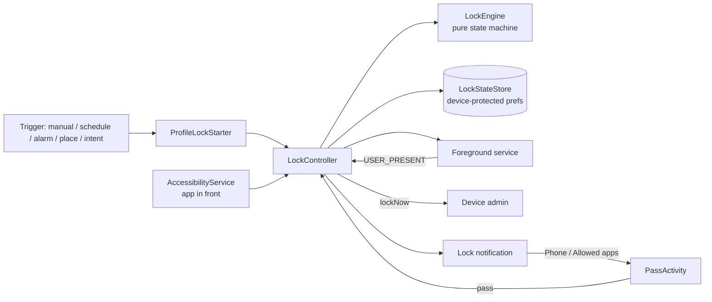

# LockMyPhone Extended

An Android app that locks your phone for a set time, and keeps it locked. It recreates the idea of Thomas Kahn's *Lock My Phone*: during a lock, **every unlock locks the phone again immediately**. Only calls, emergency calls and apps you allowed stay usable.

On top of that it adds automatic triggers (schedules, alarms, places, other apps), allowed-app passes, a timed early-unlock escape hatch, Do Not Disturb and grayscale during locks, and device-aware handling of each manufacturer's system screens.

> **Status: 0.9.0 pre-release.** The core lock, passes, schedules, early unlock and intent API have been tested on a Pixel 7 and the Android emulator. Several newer features (listed under [Test status](#test-status)) are built but not yet tested on a device. NFC tags and emergency mode aren't built yet.

---

## Contents

- [Features](#features)
- [Install](#install)
- [First-time setup](#first-time-setup)
- [Common use cases](#common-use-cases)
- [Architecture](#architecture)
- [Intent API (MacroDroid, Tasker…)](#intent-api-macrodroid-tasker)
- [FAQ](#faq)
- [Known limits](#known-limits)
- [Building from source](#building-from-source)
- [Test status](#test-status)

---

## Features

### The lock
- **Locks again on every unlock** during a lock, like Lock My Phone. The lock survives reboots and app updates, because the end time is stored as a wall-clock timestamp.
- **Quick lock:** set the length (H:M:S or one-tap presets), allowed apps and options on the Quick lock tab, then tap **Lock now**. Everything is remembered for next time. ↻ copies your Lock defaults back in.
- **Profiles:** named, reusable locks, each with an icon (built-in icons or any emoji). You can drag them to reorder, and start one with ▶ (the length can be adjusted before starting).
- **Lock defaults:** a baseline that new profiles start from, and that Quick lock can copy.
- **Countdown screen:** while locked, the app shows only the time left and the end time, so settings can't be changed mid-lock.

### During a lock
- **Allowed apps:** open them from the lock-screen notification (Phone, Allowed apps…). Leaving them, including going Home or opening the app switcher, locks the phone again.
- **Back to where you were:** if the screen turns off inside an allowed app, unlocking can either return you to that app, or show the countdown screen and lock again after a few seconds unless you pick an app. You choose this per profile.
- **Early unlock:** optional, per lock. Request it from the lock-screen notification, then wait N minutes before the lock ends. It can be cancelled.
- **Do Not Disturb:** optional, at a level of your choice: Priority only, Alarms only, or Total silence. It uses the app's own modes, so your manual DND is never overwritten.
- **Grayscale:** optional (Android 15+). The screen turns gray when the lock starts and returns to colour when it ends.
- **One pinned notification** shows the countdown and has the Phone / Allowed apps / Unlock early buttons.

### Automations (start locks automatically)
- **Weekly schedules:** days + start and end time, overnight included. Stopping a scheduled lock early (by intent or early unlock) cancels the rest of that window.
- **Alarm triggers:** lock after you dismiss an alarm. Snoozes don't count.
  - **A specific alarm:** learned from one ring, or picked from QRAlarm's upcoming alarms without waiting for it to ring.
  - **The first alarm of the day:** from Google Clock and/or QRAlarm, whichever alarm you dismiss first. Handy when you wake at different times.
  - **Timers never count.**
  - **Active on:** every day, chosen weekdays, once, or specific dates. A configurable "day starts at" time (default 2:00 AM) decides which day a late-night alarm belongs to.
  - **Missing alarms:** a warning if a learned alarm seems to have been deleted, with a one-tap **Re-link** when a re-created one is spotted.
- **Location triggers:**
  - The place is a GPS circle (25–2000 m) and/or a specific Wi-Fi router (its unique BSSID, which is exact to a building or room).
  - **How to match:** GPS only · Wi-Fi only · GPS **and** Wi-Fi · GPS **or** Wi-Fi.
  - **Behaviours:** lock *while I'm here*, *on arrival*, *when I leave*, or **during time slots**:
    - several slots per place, each with its own days
    - you choose whether to lock again when you come back mid-slot
    - you choose whether leaving unlocks or keeps the lock until the slot ends
  - **Engine:** Google Play Services geofencing (default) or Android's built-in location (no Google needed).
- **Intent API:** start or stop locks from MacroDroid, Tasker and similar apps (see [below](#intent-api-macrodroid-tasker)).

### Quality of life
- **Tabs:** Quick lock · Profiles · Automations · Settings, in a bottom bar.
- **Icons and order:** for profiles, schedules, alarm triggers and places; long-press a row to drag it.
- **Themes:** System, Light, Dark and OLED black.
- **App lists:** fast and searchable, with selected apps listed first.
- **Setup and device profiles:** a setup checklist that only shows what's still missing, and device profiles for Pixel, Samsung, Nothing and generic Android, with a Diagnostics log for adding new ones.

---

## Install

1. Download the APK from **[Releases](../../releases)**.
2. On the phone, allow installing from your browser or file manager when asked, then open the APK.
3. Open **LockMyPhone Extended** and follow the setup checklist.

> The release APK is signed with a **debug key**. That's fine for sideloading. Google Play won't accept this kind of app anyway (see the [FAQ](#faq)). If you later install a build signed with a different key, you'll have to uninstall first.

Requires **Android 11 (API 30)** or newer. Grayscale needs Android 15+.

---

## First-time setup

The checklist on the **Settings** tab only shows what's still missing:

| Permission | Why |
|---|---|
| **Device admin** | Locks the phone again (`lockNow`). Required. |
| **Notifications** | The lock countdown and its buttons. |
| **Accessibility service** | Sees which app is in front, so allowed apps work and leaving them locks. It doesn't read screen content. |
| **Run in background** (battery unrestricted) | Keeps enforcement reliable, especially on Samsung and Nothing phones. |
| **Do Not Disturb access** | Only if a lock uses DND or grayscale. |
| **Notification access** | Only if you use alarm triggers (to see alarms ringing). |
| **Precise location + "Allow all the time"** | Only if you use location triggers. |

---

## Common use cases

- **"No phone for the first hour after I wake up" (weekdays):** an alarm trigger on your QRAlarm alarm → a 1-hour profile, with Chosen weekdays Mon–Fri.
- **Weekends, when you don't know which alarm will wake you:** an alarm trigger set to *The first alarm of the day* from Clock + QRAlarm, active Sat–Sun.
- **Bedtime:** a schedule, 22:30 → 07:00 every day, starting a "Night" profile with Alarms-only DND and grayscale.
- **Focus at the office:** a location with *During time slots* Mon–Fri 9:00–12:00 and 13:00–17:00, matched by *GPS or Wi-Fi* (the office router makes it exact indoors).
  - Choose whether stepping out for lunch unlocks or keeps you locked until the slot ends.
- **Gym:** a location with *While I'm here*, allowing only your music app and the timer.
- **From another app:** a MacroDroid macro sends `START_LOCK` with `profile=Study` when you connect to a certain Bluetooth device.
- **A quick 25-minute focus burst:** Quick lock → tap the 30m preset (or your own) → Lock now.
- **Commute:** a location on your home Wi-Fi with *When I leave* → a 45-minute lock.

---

## Architecture

A single-module Android app in **Kotlin + Jetpack Compose (Material 3)**. It uses a manual dependency container (no Hilt), Room for data, and SharedPreferences for single values.

```
com.fabiantorrestech.lockmyphone_extended
├── core
│   ├── lock      LockEngine (pure rules), LockController, LockState/Store, end alarm
│   ├── enforce   Device admin receiver, Relocker (lockNow), AccessibilityService, ForegroundPolicy
│   ├── service   Foreground service (USER_PRESENT / screen on-off), BootReceiver
│   ├── notify    Lock notification, trigger warnings
│   ├── dnd       DND levels + grayscale via app-owned AutomaticZenRules
│   ├── oem       Per-manufacturer profiles + detector
│   └── apps      App list, icons, caches
├── pass          PassActivity: grants an allowed-app pass from the lock screen
├── bypass        Early-unlock notification actions
├── trigger
│   ├── schedule  ScheduleCalculator (pure) + exact-alarm scheduler
│   ├── alarm     NotificationListener, learning, first-alarm + day rules, health checks
│   ├── location  LocationRules (pure), Play Services / built-in engines, receiver, manager
│   ├── IntentApiReceiver, ProfileLockStarter
├── data          SettingsStore, Room database (profiles, schedules, alarm & location triggers, slots)
└── ui            Compose screens, SettingsKit (editor building blocks), reorderable lists
```

### How a lock is enforced



- **The unlock rule:** every unlock (`USER_PRESENT`) during a lock without an active pass → `lockNow()` after a 1-second grace. The grace lets a lock-screen shortcut grant a pass first.
- **Passes:** a pass lets allowed apps be in front. Anything else, including the launcher (home, app switcher), locks again. Screen-off pauses the pass; unlocking resumes it only if an allowed app is still in front.
- **Rules are pure Kotlin:** `LockEngine`, `ScheduleCalculator`, `AlarmDayRules`, `AlarmKinds` and `LocationRules` have no Android dependencies.
- **Direct boot:** the lock state and the database live in **device-protected storage**, so a scheduled or active lock is enforced even before the first unlock after a reboot.

### Architecture decisions
Recorded in [`doc/adr/`](doc/adr/):
1. Record architecture decisions
2. Enforce locks with Device Admin + an Accessibility service (not Device Owner)
3. Store profiles and schedules in Room, in device-protected storage
4. Detect locations with Play Services geofencing, with built-in location as an option

### Dependencies
- AndroidX Core, Activity Compose, Lifecycle
- Compose BOM + Material 3, Material Icons Extended
- Room (+ KSP)
- Google Play Services Location

---

## Intent API (MacroDroid, Tasker…)

Send a **broadcast** explicitly to package `com.fabiantorrestech.lockmyphone_extended`.

| Action | Extras |
|---|---|
| `com.fabiantorrestech.lockmyphone_extended.action.START_LOCK` | `profile` (a profile name; without it, Quick lock is used), plus optionally `duration_min` or `duration_sec` |
| `com.fabiantorrestech.lockmyphone_extended.action.STOP_LOCK` | `token`: the secret shown in **Settings → Intent API**. Only works when "Allow stopping a lock by intent" is on. |

Example (adb):
```sh
adb shell am broadcast -p com.fabiantorrestech.lockmyphone_extended \
  -a com.fabiantorrestech.lockmyphone_extended.action.START_LOCK --es profile Study --ei duration_min 45
```

- **Why stopping needs a token:** so other apps can't end your lock.
- **Why the token can't help you mid-lock:** it can't be looked up during a lock, because settings are hidden then.

---

## FAQ

**Can I get out of a lock?**
- Only in the ways you set up beforehand:
  - early unlock (after its wait)
  - a token-protected intent
  - leaving a "while here" place, or leaving during a slot if that's set to unlock
- Calls and emergency calls always work.
- Android itself still offers escape routes that no app without Device Owner can block (see [Known limits](#known-limits)).

**Does the accessibility service read my screen?**
No. It only receives the package name of the window in front, to know whether you're in an allowed app.

**Why isn't it on Google Play?**
Play's policy doesn't allow using the accessibility service for this purpose, so the app is sideload-only.

**Will my alarm still ring during a lock / with DND?**
- **Priority only** and **Alarms only:** alarms ring.
- **Total silence:** alarms are silenced too, and the editor warns about this.

**Why "internal alarm #1" for QRAlarm?**
QRAlarm doesn't put alarm names in its notifications, so the app follows its internal alarm number. Editing the alarm's time or name in QRAlarm is fine. Deleting it breaks the link; the app warns you and can re-link to a re-created alarm.

**Will a Google Clock timer trigger a lock?**
No. Timers and stopwatches never count as alarms, and learning refuses a timer.

**How exact are location triggers?**
- **GPS:** usually 5–20 m outdoors, but it can drift 30–100 m indoors. That's why leaving counts only once you're clearly past the edge, by at least 20 m or the reading's accuracy if that's bigger.
- **Wi-Fi rule:** exact to the router's building or room.
- **Match modes:** *GPS or Wi-Fi* is the most reliable indoors; *GPS and Wi-Fi* is the strictest.

**Does location use a lot of battery?**
- **Play Services (default):** battery-friendly geofences. Small circles are double-checked about every 2 minutes, only while you're near the place.
- **Built-in engine:** uses more battery.

**Grayscale didn't turn on.**
- It needs **Android 15+** and **Do Not Disturb access**.
- The mode ("LockMyPhone grayscale") appears in Settings → Modes, where you can check it.

**What happens after a reboot during a lock?**
The lock resumes, because it's stored in device-protected storage and the end time is absolute. Location watching is re-registered after boot.

---

## Known limits

These are the same as Lock My Phone; they can't be fixed without Device Owner:
- Rebooting into **safe mode** disables third-party apps, including this one.
- **ADB** or a **factory reset** can remove the app.
- **Samsung and Nothing device profiles** are unverified. Use **Settings → Diagnostics → Copy** to help confirm them.
- **Android 11:** lock-screen notification buttons may ask you to unlock first; the phone locks again right after.

---

## Building from source

Requirements: Android Studio (2026.1 or newer; uses its bundled JDK), Android SDK 37.

```sh
./gradlew assembleDebug     # debug build
./gradlew assembleRelease   # R8-optimized, signed with the debug key
```

- On Windows from a shell, set `JAVA_HOME` to Studio's `jbr` folder first.
- The APKs are written to `app/build/outputs/apk/`.

---

## Test status

| Area | Status |
|---|---|
| Relock on unlock, passes, app switcher, boot resume | ✅ Tested (emulator + Pixel 7) |
| Schedules, intent API, early unlock, DND (priority) | ✅ Tested (emulator) |
| App lists, fast scroll, QRAlarm upcoming picker | ✅ Tested (Pixel 7) |
| Alarm triggers (Google Clock) | ✅ Tested (emulator) |
| Resume after screen-off, Lock defaults, DND levels, grayscale, presets, editor redesign, icons, reordering, first-alarm + day rules, timer exclusion, missing-alarm warnings, location triggers + time slots, release build | 🟡 Built, not yet tested on a device |
| NFC tags + gate screen, emergency mode | ⬜ Not built yet |
